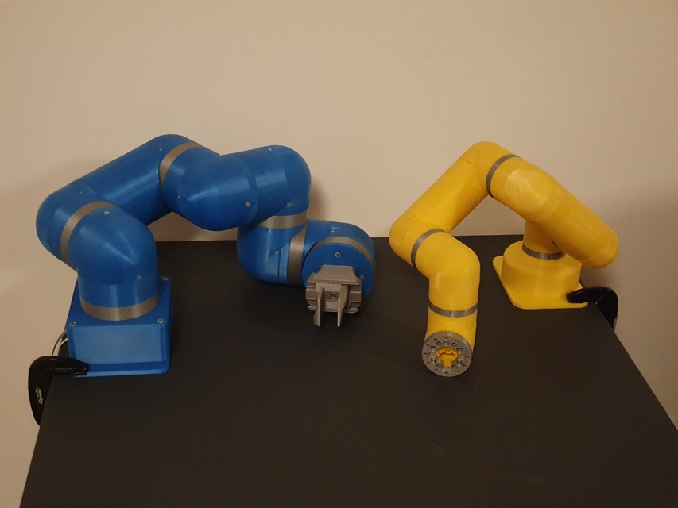
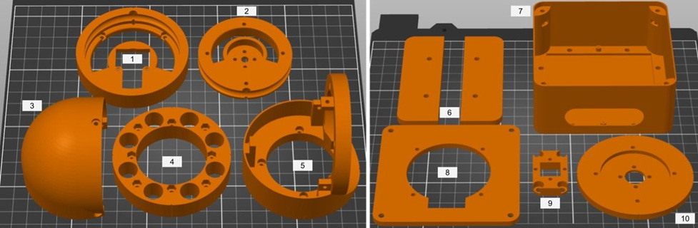
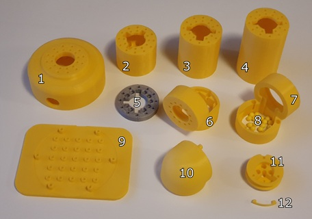
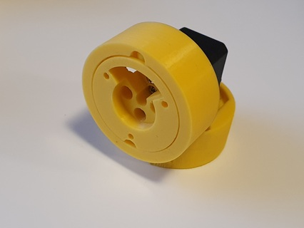
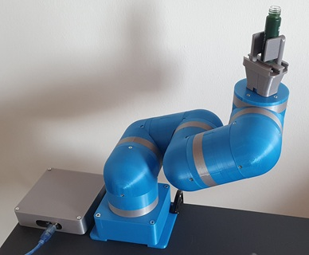
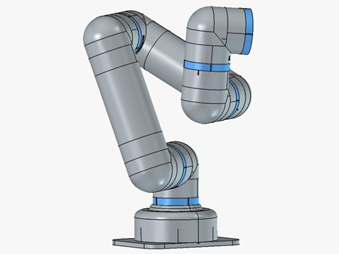
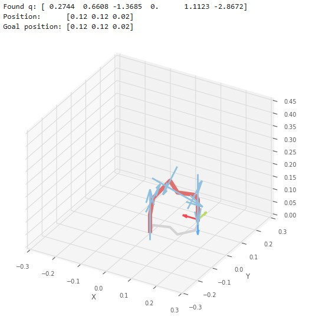
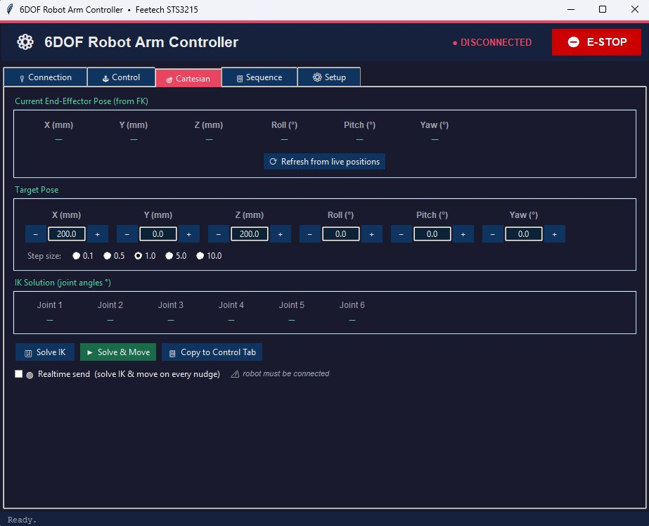

# MECHO: Modular Extensible Cobot for Human-Centered Operations

This repository contains files for the development of modular robotic arm platform.

The platform is based on the well-known Feetech STS3215-12V smart servo motors: [https://www.dfrobot.com/product-2962.html](https://www.dfrobot.com/product-2962.html).

It was also tested with Herkulex DRS-0101, but they have requirement for 7.5V power supply and encoder with a lower resolution. Also, the Dynamixel AX-12A was considered, but the dimensions were not suitable for the application.

This GitHub repository contains two version of the robot: V1 with links with a cross sectional diameter of 80 mm and V2 with a cross sectional diameter of 50 mm. Both versions are shown in the following image where the blue robot is V1 and the yellow robot is V2:

[](./images/robots.jpg)

## 80 mm version of the robot: V1

Different constructions with a circular cross section with a diameter of 80 mm can be built by using the following V1 parts:

1. Actuator motor housing;
2. Actuator output ring;
3. 90-degree bracket cover;
4. 15 mm spacer;
5. 90-degree bracket;
6. Base clamp mount bracket;
7. Base box;
8. Base cover;
9. Gripper mounting bracket;
10. Tool mounting bracket.

The version V1 parts are shown in the following image:

[](./images/V1/parts.jpg)

For the bearing assembly of each actuator you need 6 mm plastic (airsoft) balls.

## 50 mm version of the robot: V2

V2 is the current version which is under active development. It requires less number of parts for each of the joints. The diameter of the cross section of V2 is reduced to 50 mm. Also, another big advantage is that V2 requires only a single type of bolts M3x16 mm and M3 hex nuts.

V2 robot can be built with the following parts:

1. Robot base;
2. 40 mm connector;
3. 60 mm connector;
4. 80 mm connector;
5. 8 mm connector;
6. 90 degree angle connector;
7. Servo motor actuator housing;
8. 6 mm plastic (airsoft) bearing balls;
9. Base and control board plate;
10. Cover cap for the actuator housing (7) or for the 90 degree angle connector (6);
11. Servo motor actuactor output ring;
12. Cover cap for the servo motor bolt holes of the actuator housing (7).

The different parts of the version V2 are shown in the following image:

[](./images/V2/parts.jpg)

The bearing assembly of each actuator requires 6 mm plastic (airsoft) balls. The assembled robot actuator joint is shown in the following figure.

[](./images/V2/actuator.jpg)

## Robotic Gripper

For the robotic gripper the Micro Servo Parallel Gripper by Techniccontroller is used: [https://grabcad.com/library/micro-servo-parallel-gripper-1](https://grabcad.com/library/micro-servo-parallel-gripper-1).

## Control Box

Currently, the control box of the robot. For the control of the robot an [Arduino Mega 2560 board](https://store.arduino.cc/products/arduino-mega-2560-rev3) is used. for the communication with the servo motors a dedicated [Serial Bus Servo Driver Board](https://www.dfrobot.com/product-3002.html) is connected to a UART port of the Arduino. An additional [25W DC-DC Power Module](https://www.dfrobot.com/product-752.html) is added to the control box for providing stable 5V output for the end effector and if needed also for the Arduino.

The V1 robot assembled in a 6 degree of freedom configuration and the control box are shown in the following image.

[](./images/V1/robot.jpg)

## Experiments and Videos

Executions of the Task Board v2023 tasks: button press and circuit probing tasks of the Task Board v2023: [https://github.com/peterso/robotlearningblock](https://github.com/peterso/robotlearningblock) are shown in the following video: [https://youtu.be/xAtnlniCpGE](https://youtu.be/Kb3CY3zpSdE).

Demonstration of the execution of a task to pick up a bottle lying in a horizontal position and place it in another place, but this time in a vertical position is shown in the following video: [https://youtu.be/xAtnlniCpGE](https://youtu.be/xAtnlniCpGE).

[](https://youtu.be/xAtnlniCpGE)

## CAD and STL files

In the folder [CAD](./CAD/) you can find the source CAD files. They were delevoped by using the FreeCAD software: [https://www.freecad.org/](https://www.freecad.org/).

Different robot configurations with 4, 5 or 6 degrees of freedom in a CAD environment can be found in the folder [CAD/Assemblies](./CAD/Assemblies/).

In the folder [STLs](./STLs/) you can find the exported STL files which can be 3D printed.

Currently, there are two versions. The version V1 is with a cross section of cirle with 80 mm in diameter. The version V2 is a new slimmer version of the robot with a diameter of 50 mm and with less number of parts to reduce the overall weight.

V2 robot assembled with 6 degrees of freedom is shown in the following figure.

[](./images/V2/RobotV2_6DOF.jpg)

## Kinematics

In the folder [Kinematics](./Kinematics/) you will find a useful example Jupyter notebooks which shows how the forward and inverse kinematics can be solved by using Robotics Toolbox for Python.



## Software

The folder [Software](./Software/) contains useful Python and ROS 2 packages and application for the control of the robot when STS3215 servo motors are used. 

### Python Control App

You can run the Python control app software with the following commands:

```bash
cd Software/Python
python app.py
```



It is still under active development.

### Dedicated Python Packeges

There are also `robot_api` and `robot_arm` python packages which can be installed locally and used for coding python programs for the control of the robot. The packages can be installed locally in editable mode with: `pip install -e .`. An example program can be found in [./Software/Python/test_api.py](./Software/Python/test_api.py). This API is similar to the Python API for the commercial xArm cobots: [https://github.com/xArm-Developer/xArm-Python-SDK](https://github.com/xArm-Developer/xArm-Python-SDK).

### Arduino Firmware

You can also find the firmware for the Arduino board in the folder [./Software/Arduino/arduino_controller/](./Software/Arduino/arduino_controller/). This firware allows you to use a regular PWM (micro) servo for the gripper. The firmware will assign to it a virtual ID 7 and be able to control it with the same library and commands as those for the other smart STS3215-12V servos. The library for the servos is described in [https://github.com/vassar-robotics/feetech-servo-sdk](https://github.com/vassar-robotics/feetech-servo-sdk).

### ROS 2 Support

The ROS 2 packages with configured MoveIt can be found in the folder [./Software/ROS2/](./Software/ROS2/). The joystick control can be started with the script [./Software/ROS2/scripts/run_joy.py](./Software/ROS2/scripts/run_joy.py). It is tested and running on Raspberry Pi 4 under Ubuntu OS.

## License

Everything is this repository is licensed under the standard MIT license.